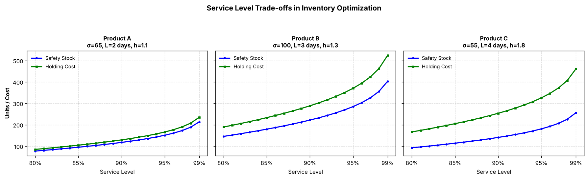

# Multi-Product Inventory Strategy: Service-Level Trade-offs

Advanced service-level trade-off simulation for three products with different demand patterns and cost structures. It shows how the service level drives **safety stock** (inventory risk) and **holding cost** (financial impact), and recommends a service level per product.



## Formulas

- **Z-score:** `Z = norm.ppf(service level)`, for service levels from 80% to 99%
- **Safety stock** = Z × σ × √(Lead time)
- **Holding cost** = Safety stock × Holding cost per unit
- **Cost-balancing service level** (critical ratio) = p / (p + h), where p = cost of a lost sale per unit, h = holding cost per unit

## Products

| Product | Avg demand/day | σ (demand/day) | Lead time (days) | Holding cost/unit | Lost-sale cost/unit |
|---|---|---|---|---|---|
| A | 400 | 65 | 2 | 1.10 | 20 |
| B | 650 | 100 | 3 | 1.30 | 12 |
| C | 300 | 55 | 4 | 1.80 | 45 |

## Results

| Product | Safety stock @90% | @95% | @99% | Holding cost @95% | @99% | Recommended service level |
|---|---|---|---|---|---|---|
| A | 118 | 151 | 214 | 166 | 235 | 94.8% |
| B | 222 | 285 | 403 | 370 | 524 | 90.2% |
| C | 141 | 181 | 256 | 326 | 461 | 96.2% |

- **Non-linear:** going from 95% to 99% raises safety stock and holding cost by **41%** for every product. Those last 4 points cost about **80%** as much as the previous 15 points (80% → 95%).
- **Products differ through σ·√L:** Product B needs the largest buffer at every service level. Product C's high holding cost makes its cost curve the steepest relative to its buffer.
- **Policy:** differentiated targets (A 95%, B 90%, C 96%) put service where a stockout hurts most, instead of a blanket target for all products.
- **Levers:** +50% demand variability means +50% safety stock; doubling the lead time adds only √2 ≈ +41%.

## Files

| File | Purpose |
|---|---|
| `service_level_tradeoff.py` | Standalone script (Colab or command line): prints the tables and draws the side-by-side subplots |
| `app.py` | Streamlit dashboard: editable product inputs, the trade-off subplots, quantified impact, recommendation, variability and lead-time sensitivity |
| `service_level_tradeoffs.png` | The chart produced by the script |

## Run

```bash
pip install -r requirements.txt
python service_level_tradeoff.py      # tables + chart
streamlit run app.py                  # dashboard
```

**Streamlit Cloud:** share.streamlit.io → Create app → this repository, branch `main`, main file `app.py`.
